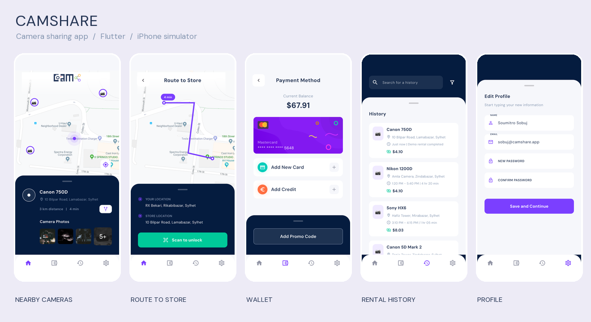

# Camshare · 相机共享 Flutter App

根据 Pixso「Page 1」的 19 张移动端界面开发，保留紫色主色、深蓝面板、地图视图和圆角导航。项目包含可操作的本地演示流程、持久化状态、自动化测试和界面截图。



## 交付内容

- [项目结构与架构说明](docs/项目说明.md)：功能、目录、状态流转、设计对应关系、运行与验证方法。
- [全部界面截图](docs/界面截图.md)：19 张 iPhone 模拟器界面与原始 PNG。
- [Pixso 原稿备份](docs/reference/)：19 张原始设计图，编号与实现截图对应。
- `lib/`：Flutter 源代码；`test/`：业务与布局测试；`integration_test/`：完整流程测试。

## 运行

开发环境：Flutter 3.41.6 / Dart 3.11.4。

```sh
flutter pub get
flutter run
```

首次进入欢迎页。可以注册或登录本地演示身份：任意有效邮箱与不少于 6 位的密码即可，密码不会保存。社会化登录按钮提供明确提示后的演示入口。

体验流程：登录 → 点击相机名称查看规格 → 路线 → 扫码 → 输入任意 4 位数字 → 解锁 → 首页归还 → 历史记录。钱包中可以添加测试卡、选择充值金额和使用优惠码。

| 演示数据 | 内容 |
| --- | --- |
| 初始余额 | $72.01 |
| 测试卡号 | `4242 4242 4242 4242` |
| 有效期 / CVV | `12/30` / `123` |
| 优惠码 | `CAMSHARE1578`，增加 $10，限用一次 |
| 租借结算 | 每次演示租借 $4.10，归还后扣款并生成记录 |

当前交付为离线交互演示：地图、GPS、扫码、认证和支付尚未连接真实服务。数据保存在当前设备，卡片只保存末四位；不会发起真实交易。

## 检查与截图

```sh
flutter analyze
flutter test
flutter drive \
  --driver=test_driver/integration_test.dart \
  --target=integration_test/app_test.dart \
  -d <模拟器设备ID>
```

最后一条命令会运行完整交互流程，并重新生成 `docs/screenshots/` 内的 19 张界面截图。测试使用独立存储键，不覆盖日常演示数据。
