# Camshare 全部界面截图

以下 19 张 PNG 由 iPhone 17 Pro 模拟器的集成测试生成，分辨率 1206×2622。测试截图截取 Flutter 视图，原生状态栏不包含在内。编号与 `reference/` 中的 Pixso 原稿一一对应。点击图片可打开原图。

| 01 欢迎 | 02 注册 | 03 登录 |
| --- | --- | --- |
|  |  |  |

| 04 附近相机 | 05 相机规格 | 06 到店路线 |
| --- | --- | --- |
| 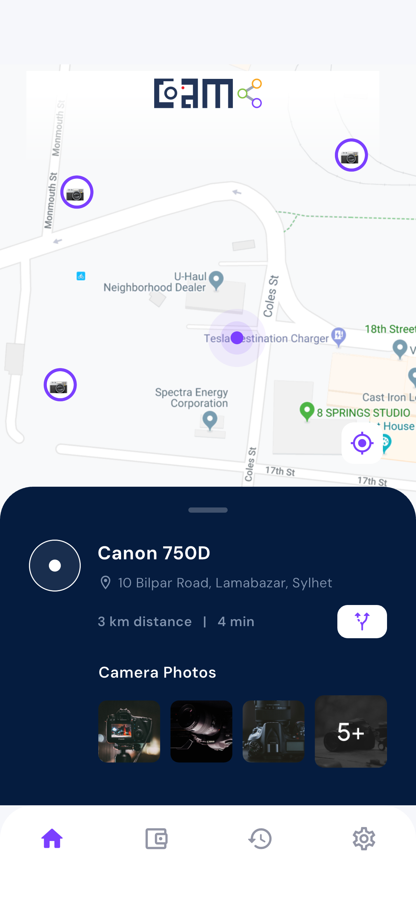 | 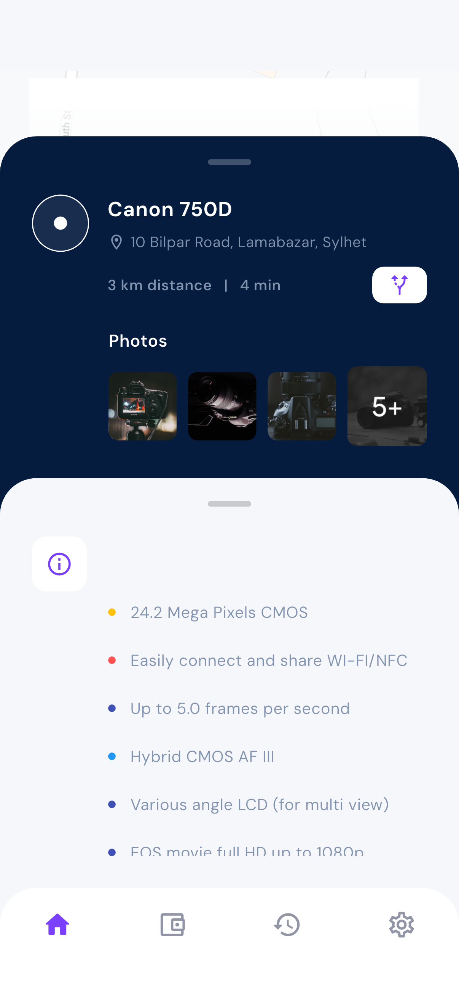 | 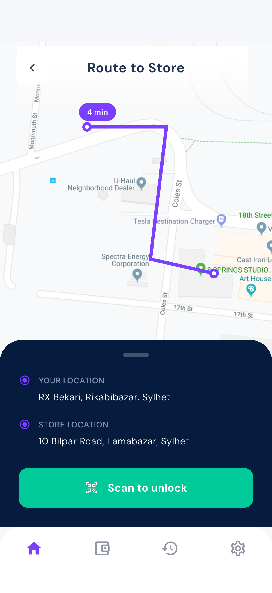 |

| 07 扫码 | 08 编号输入中 | 09 编号可提交 |
| --- | --- | --- |
| 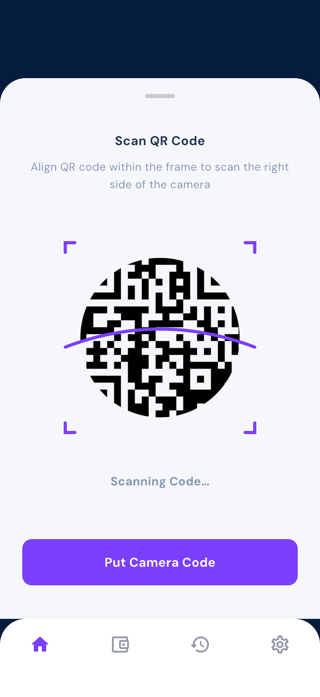 | 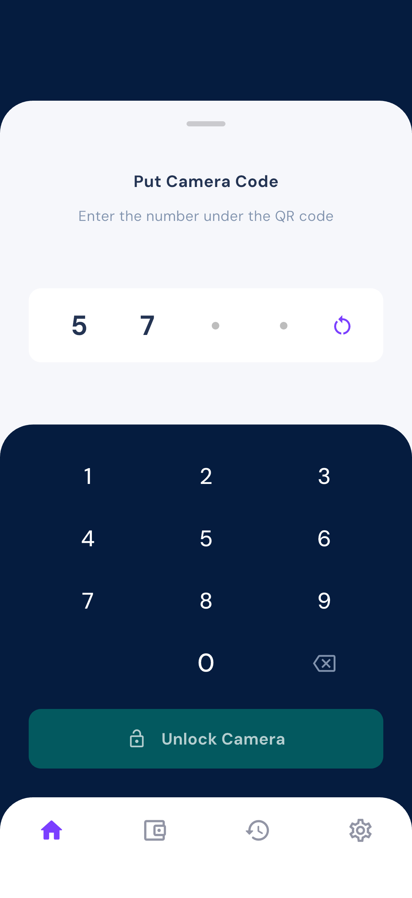 | 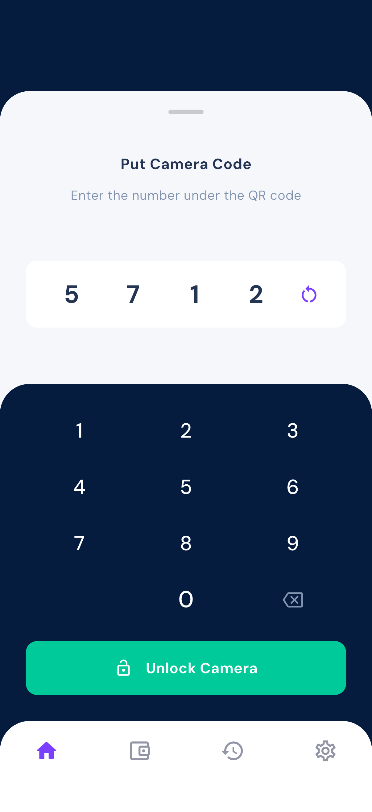 |

| 10 钱包 | 11 添加卡片 | 12 支付确认 |
| --- | --- | --- |
|  | 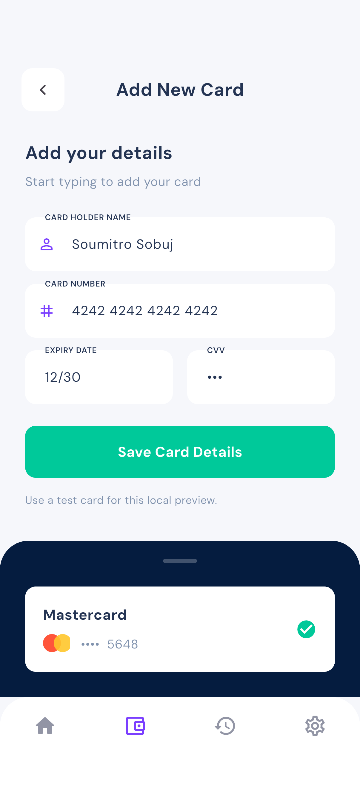 | 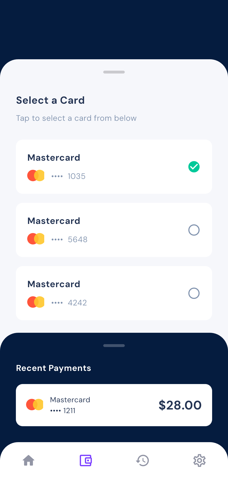 |

| 13 添加成功 | 14 充值 | 15 充值彩色风格 |
| --- | --- | --- |
|  | 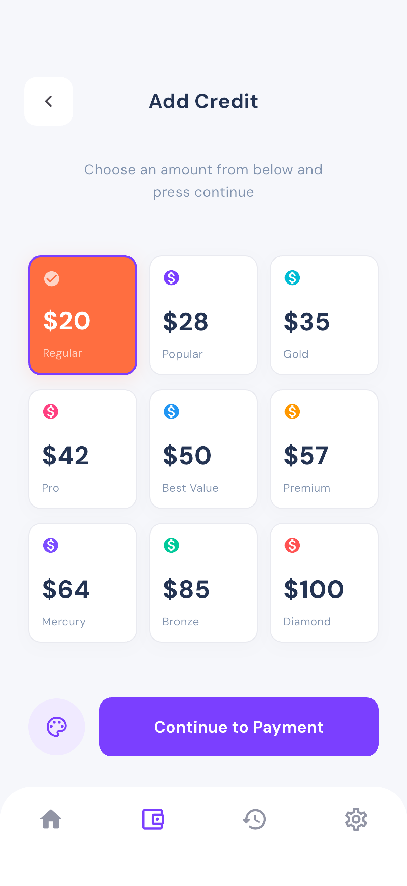 | 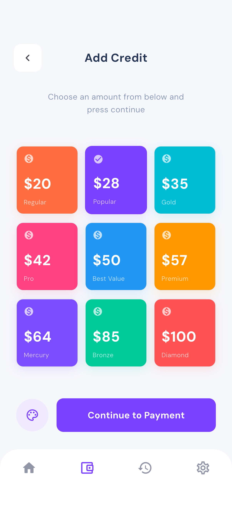 |

| 16 优惠码 | 17 照片 | 18 租借历史 |
| --- | --- | --- |
|  | 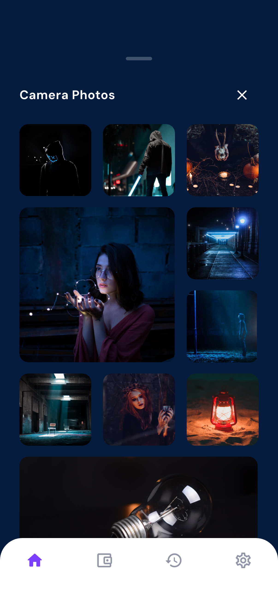 | 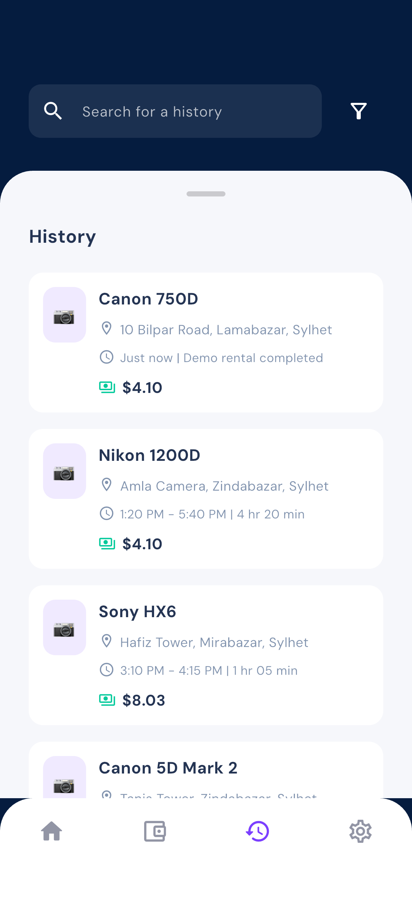 |

| 19 资料设置 |
| --- |
| 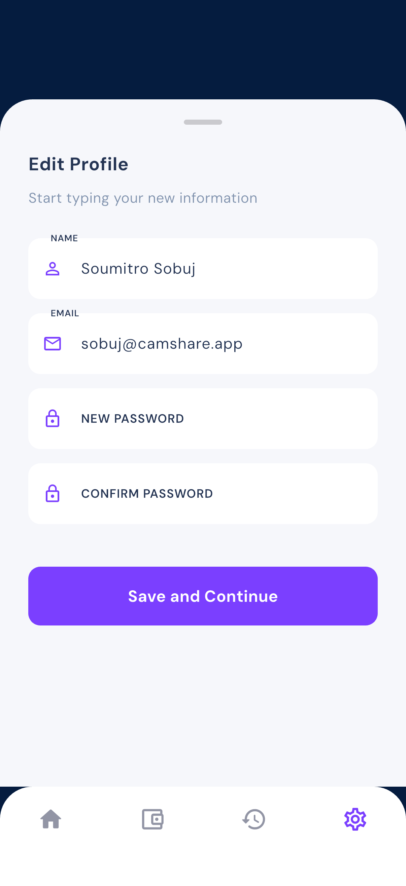 |

重新生成方式见[README](../README.md)中的集成测试命令。主要界面总览可通过 `scripts/create_overview.py` 重新生成。
